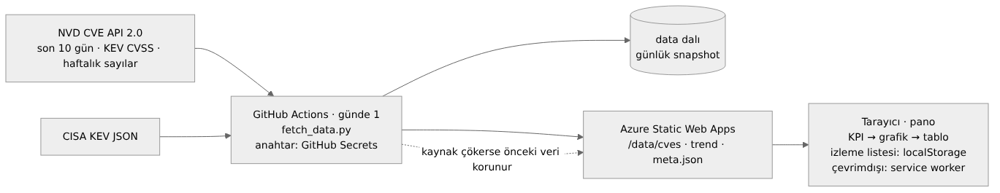
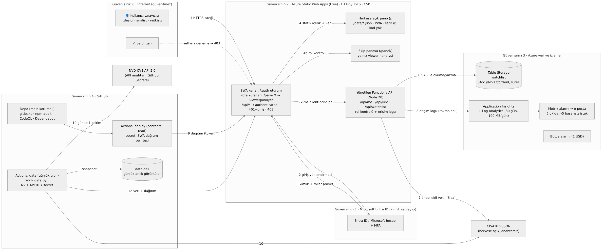

# Zafiyet İstihbarat Panosu

CVE/KEV verisiyle zafiyet önceliklendirme panosu: Zero Trust erişim kontrollü, güvenli bulut yayını.

**Canlı ürün:** ⟦https://xxx.azurestaticapps.net⟧ · **Vaka çalışması:** https://kaansemihkurt.vercel.app/projeler/zafiyet-panosu · **Demo videosu:** ⟦link⟧

Manisa Celal Bayar Üniversitesi, Büyük Veri Analistliği, 2026 Güz. Aynı ürün ve aynı depo iki dersin haftalık sprint ödevidir:
- **BVA 2245 Kullanıcı Arayüzü Tasarımı:** ürünün *ne yaptığı*: canlı veri ürünü (`/`).
- **Bulut Bilişim ve Siber Güvenlik:** ürünün *nasıl güvenli, sürekli ve izlenebilir çalıştığı* (`/panel/`, altyapı, CI/CD).

> Kurgusal bir müşteri (bir üniversitenin bilgi işlem güvenlik ekibi) için hazırlanmış ders projesidir; resmî bir kurum aracı değildir.

## CV cümleleri
- **Arayüz:** *NVD CVE API 2.0 ve CISA KEV verisini GitHub Actions ile her gün çeken, izleme listesi ve açıklanabilir öncelik puanıyla kritik zafiyetleri sıralayan erişilebilir SOC panosu geliştirdim (ECharts, PWA, TR/EN; Lighthouse mobil erişilebilirlik ⟦X⟧, performans ⟦Y⟧).*
- **Güvenlik:** *Zafiyet istihbarat panomu Azure Static Web Apps'e Bicep ile taşıdım; Entra ID + MFA ile Zero Trust erişim ve izleyici/analist rol bazlı yetkilendirme kurdum, yetkisiz erişimin 403 aldığını erişim logları ve alarmla kanıtladım; anahtarları kasaya taşıdım, ZAP bulgularını ⟦X⟧'ten ⟦Y⟧'ye indirdim.*

## Ürün (`/`)
Kullanıcı: sabah vardiyasında öncelik belirleyen güvenlik analisti.

| | |
|---|---|
| **KPI** | Filtrelenen CVE · Kritik (CVSS ≥ 9) · KEV'de (fidye kullanımıyla) · izleme listesi eşleşmesi |
| **Ana grafik** | Son 12 haftanın haftalık yeni CVE sayısı (NVD) + haftalık KEV eklemeleri |
| **İkincil grafik** | Filtrelenen kayıtların CVSS önem dağılımı |
| **Filtreler** | Arama, kapsam (son 10 gün / KEV / hepsi), önem derecesi, yalnızca KEV, yalnızca izleme listesi |
| **Tablo** | Öncelik, CVE, CVSS, yayın, KEV, üretici/ürün, açıklama; sütunlara göre sıralanabilir, 50'lik sayfalar |
| **İleri özellik** | Tarayıcıda saklanan izleme listesi (ürün/üretici anahtar kelimeleri), KEV işaretleri, CVSS dağılımı, haftalık trend, öncelik sıralaması |
| **Öncelik puanı** | 50 × CVSS/10 + 30 (KEV) + 10 (fidye) + 10 (izleme listesi). Her satırda gerekçesi görünür |
| **Tasarım kısıtı** | 1920 px'te üç sütunlu yoğun SOC düzeni, 360 px'te mobil özet (KPI → öncelik → grafik → tablo kartları), koyu tema, klavye kısayolları (`?` ile liste) |
| **Durumlar** | İskelet yükleme, boş sonuç, hata; veri alınamazsa tarayıcıdaki son başarılı veriyle açılır ve bunu söyler. Kaynak çökerse veri hattı önceki veriyi korur ve arayüz uyarır. Test için: `/?veri=/bozuk/` |
| **Erişilebilirlik** | Klavye, görünür odak, kontrast ≥ 4.5:1. Her grafikte otomatik özet ve "Veriyi tablo olarak gör". Renk yanında ikon, desen ve metin |
| **Bonus** | PWA (yüklenebilir, çevrimdışı son veri), TR/EN |

## Veri hattı


1. `.github/workflows/data.yml` her gün 07:15'te (TR) `pipeline/fetch_data.py` çalıştırır. Betik yalnızca Python standart kütüphanesini kullanır ve şunları çeker:
   - NVD: son 10 günde yayımlanan CVE'ler, KEV'deki CVE'lerin CVSS puanları (`hasKev`), son 12 haftanın haftalık sayıları
   - CISA KEV kataloğu
2. NVD API anahtarı yalnızca **GitHub Secrets** (`NVD_API_KEY`) içindedir; istemci koduna hiçbir anahtar girmez. Hız sınırına uyulur: anahtarsız 6,5 sn, anahtarlı 0,8 sn bekleme.
3. Her çalıştırma `data` dalına günlük **anlık görüntü** yazar (`history/YYYY-MM-DD.json`). Kaynak geçmiş özet vermediği için KEV'in gün gün büyümesi kendi serimizde birikir.
4. Veri `app/data/` altına kopyalanıp Azure Static Web Apps'e yayınlanır. Bir kaynak çökerse önceki başarılı veri korunur; `meta.json` bunu kaydeder.

**Kaynaklar ve lisans:**
- NIST NVD (https://nvd.nist.gov): *"This product uses the NVD API but is not endorsed or certified by the NVD."*
- CISA KEV (https://www.cisa.gov/known-exploited-vulnerabilities-catalog)
- İkisi de ABD kamu malı.

## Güvenlik ve altyapı (Bulut dersi)


| Alan | Kontrol |
|---|---|
| Zero Trust erişim | `/panel/` ekip panosu: SWA kimlik doğrulaması (Entra ID + MFA), yalnız `viewer`/`analyst`, roller davetle verilir, rolsüz hesap 403 alır, rol API'de yeniden denetlenir |
| Erişim logu ve alarm | Her ALLOW/DENY kararı takma adlı olarak Application Insights'a yazılır; 5 dk'da 5'ten fazla başarısız istekte e-posta |
| Gizli anahtarlar | İstemcide ve depoda anahtar yok. Tablo SAS'ı Bicep ile uygulama ayarına yazılır. Dağıtım belirteci ve NVD anahtarı GitHub Secrets'ta |
| CI/CD | Dağıtım iş akışı `contents: read`; veri iş akışı yalnızca `data` dalına yazar; gitleaks, npm audit, CodeQL, Dependabot, Scorecard açık; `main` korumalı |
| Web | HTTPS + HSTS; satır içi kod olmadan CSP (ECharts da yerel dosyadan); güvenlik başlıkları; `security.txt` |
| IaC | `infra/main.bicep`, `infra/budget.bicep` |

Tehdit modeli: [`docs/threat-model.md`](docs/threat-model.md) · Runbook: [`docs/runbook-api-key-leak.md`](docs/runbook-api-key-leak.md)

## Kurulum
Adım adım: [`docs/KURULUM.md`](docs/KURULUM.md). Yerelde denemek için:
```bash
python pipeline/fetch_data.py --out app/data        # (NVD_API_KEY ortam değişkeni isteğe bağlı)
cd app && python -m http.server 8080                # http://localhost:8080
cd api && npm test; python -m unittest pipeline/test_fetch_data.py
```

## Depo yapısı
```
app/        pano (/), ekip panosu (/panel/), PWA, SWA yapılandırması
api/        Azure Functions (ekip panosu API'si, sıfır bağımlılık) + testler
pipeline/   veri hattı (fetch_data.py) + testler
config/     hardened / baseline SWA yapılandırmaları
infra/      Bicep
docs/       mimari, veri hattı, tehdit modeli, runbook, kurulum, kullanıcı testi, demo videosu
scripts/    demo-video.mjs (altyazılı demo kaydı)
.github/    data (günlük), deploy, security, zap-baseline, codeql, scorecard, dependabot
```

## Kullanıcı testi
Protokol ve bulgular: [`docs/KULLANICI-TESTI.md`](docs/KULLANICI-TESTI.md). 2 katılımcı ve 3 görev yapıldı; önce/sonra görselleri `docs/test/` altında. ⟦DOLDUR: tek cümlelik bulgu⟧

## Yapay zekâ kullanım beyanı
- **Araç:** Claude (Anthropic).
- **Kullanıldığı işler:**
  - veri hattı betiği ve testleri
  - pano arayüzü (HTML/CSS/JS)
  - ekip panosu API'si
  - Bicep
  - GitHub Actions iş akışları
  - tehdit modeli, runbook, rapor ve README taslakları
  - demo kayıt betiği
- **Benim yaptıklarım:**
  - Azure ve GitHub kurulumu, rol atamaları
  - Taramalar (ZAP, Observatory, securityheaders, Lighthouse)
  - Kullanıcı testi
  - Ekran görüntüleri ve video kaydı
- **Çıktıda yaptığım değişiklikler:** ⟦DOLDUR: ör. kullanıcı testinden sonra … değiştirdim; öneri anahtar kelimelerini kurumuma göre güncelledim⟧

## Lisans
Kod: MIT. Apache ECharts: Apache-2.0 (`app/assets/vendor/ECHARTS_LICENSE.txt`). Veri: NVD ve CISA KEV (ABD kamu malı).
