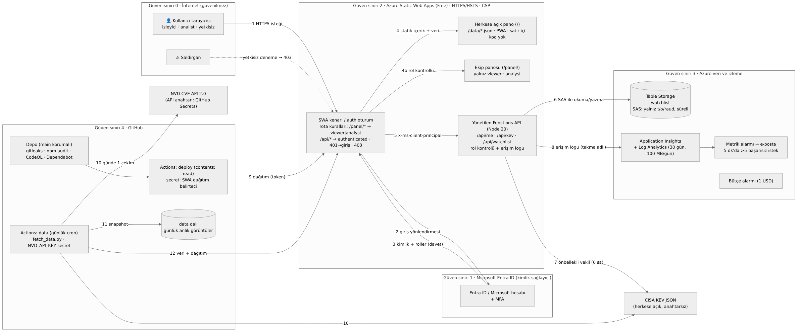

> **Nasıl doldurulur:** `⟦DOLDUR⟧` ile işaretli her yere kendi değerini ve ekran görüntüsünü koy (Ekle → Resim). Bu kutuyu sil, sonra *Dosya → PDF olarak kaydet*. Ekran görüntülerinde tarih ve saat görünmeli.

# Yönetici özeti

- **Ürün ve korunan varlık:** Zafiyet İstihbarat Panosu; CISA'nın aktif istismar edilen zafiyetler kataloğunu (KEV) ve ekibin izleme listesiyle önceliklerini gösterir.
- **Kartın öncelikli tehdidi:** kurum içi panoya yetkisiz erişim, yani izleme listesi ve önceliklerin dışarıdan görülmesi.
- **Altyapı:** Ürün, **Azure Static Web Apps (Free)** üzerinde **Bicep ile kod olarak** kuruldu. Erişim **Zero Trust** ilkesiyle tasarlandı: her istek Microsoft Entra ID / Microsoft hesabı ve **MFA** ile doğrulanır; panoyu yalnızca davetle **izleyici** veya **analist** rolü verilen kişiler görür; yalnızca analist düzenler.
- **Doğrulama:**
  - Rolsüz hesap **403** aldı: ⟦DOLDUR: ✔ / şekil no⟧.
  - İzleyicinin yazma isteği **403** aldı: ⟦DOLDUR⟧.
  - Bu denemeler erişim loglarında **DENY** olarak göründü ve alarm e-postası tetiklendi: ⟦DOLDUR⟧.
- **Anahtarlar:** Depoda, istemcide ve loglarda geçerli anahtar yok. CI/CD en az yetkiyle çalışıyor; gizli anahtar ve bağımlılık taramaları açık; `main` dalı korumalı.
- **Tarama sonuçları:**
  - OWASP ZAP baseline uyarıları: **⟦DOLDUR: önce X⟧ → ⟦DOLDUR: sonra Y⟧** (yüksek risk: ⟦DOLDUR⟧).
  - Mozilla Observatory: **⟦DOLDUR⟧**.
  - securityheaders.com: **⟦DOLDUR⟧**.
- **Maliyet:** aylık tahmin **≈ 0,10 USD** (öğrenci kredisinden karşılanır, cepten 0 TL); 1 USD'lik bütçe alarmı kurulu.

# 1. Mimari

| Bileşen | Görev | Güven sınırı |
|---|---|---|
| Kullanıcı tarayıcısı | İzleyici, analist ya da yetkisiz kişi | 0 · İnternet (güvenilmez) |
| Entra ID / Microsoft hesabı | Kimlik doğrulama + MFA | 1 · Kimlik sağlayıcı |
| SWA kenarı | HTTPS/HSTS, oturum (`/.auth`), rota kuralları, güvenlik başlıkları | 2 · Uygulama |
| Herkese açık pano (`/`) | NVD + KEV verisi (`/data/*.json`), PWA, satır içi kod yok | 2 |
| Ekip panosu (`/panel/`) | İzleme listesi ve öncelikler (korunan varlık) | 2 |
| GitHub Actions `data` | Günlük NVD + KEV çekimi, `data` dalına anlık görüntü | 4 |
| Functions API | `/api/me`, `/api/kev` (vekil + önbellek), `/api/watchlist` (rol kontrolü + erişim logu) | 2 |
| Table Storage | İzleme listesi (korunan varlık) | 3 · Veri |
| Application Insights + Log Analytics | Erişim ve hata logları, metrik alarmı | 3 |
| CISA KEV | Herkese açık, anahtarsız veri kaynağı | Dış |
| GitHub + Actions | Kod, taramalar, dağıtım | 4 |

**Kod olarak altyapı (`infra/main.bicep`):** Static Web App (Free), uygulama ayarları (SAS dahil), depolama hesabı ve `watchlist` tablosu, Log Analytics (30 gün, günlük 100 MB tavan), Application Insights, eylem grubu, metrik alarmı. Bütçe ayrıca `infra/budget.bicep` dosyasında.

**Portaldan veya elle yapılanlar:**

- Kaynak grubu (CLI)
- SWA rol davetleri
- Hesaplarda MFA ayarı
- GitHub güvenlik ayarları ve dal koruması
- ⟦DOLDUR: bütçe Bicep yerine portaldan kurulduysa buraya ekle⟧

**En az yetki:**

| Kimlik | Yetki | Neden gerekli |
|---|---|---|
| `deploy` iş akışı | `contents: read` | Yalnızca kodu okuyup paketler; depoya yazmaz |
| `data` iş akışı | `contents: write` (pratikte yalnız `data` dalı; `main` dal koruması push'u engeller) | Günlük anlık görüntüyü veri dalına yazmak için |
| `NVD_API_KEY` (GitHub Secret) | Yalnızca NVD okuma | Yalnızca `data` iş akışında ortam değişkeni olarak kullanılır; istemciye ve çıktı dosyalarına girmez (testle doğrulandı) |
| SWA dağıtım belirteci (GitHub Secret) | Yalnız bu SWA'ya yayın | Dağıtım için tek gereken yetki |
| Tablo SAS (uygulama ayarı) | Yalnız Table servisi, nesne düzeyi, `r/a/u/d`, HTTPS, 2027-02-28'e kadar | API yalnızca izleme listesi kayıtlarını okur ve yazar; tablo silme veya hesap yönetimi yok |
| `viewer` rolü | Pano ve listeyi okuma | Ekip üyeleri durumu görmeli |
| `analyst` rolü | Liste ekleme, güncelleme, silme | Öncelikleri yalnızca analist belirler |
| `codeql` / `scorecard` iş akışları | `security-events: write` (+ `id-token: write`) | SARIF sonucunu Code scanning'e yüklemek için |
| App Insights bağlantı dizesi | Yalnızca telemetri yazma | Logları toplamak için |

# 2. Tehdit modeli (STRIDE)

Olasılık × Etki (1–5) ile puanlandı; 12 tehdit. Ayrıntı: `docs/threat-model.md`.

| # | STRIDE | Varlık / akış | Tehdit | O×E | Risk | Önlem | Kalan |
|---|---|---|---|---|---|---|---|
| **T1** | **Information disclosure** + Elevation | Akış 1→4/5 · `/panel/*`, `/api/watchlist` | **Yetkisiz kişi panoyu açıp izleme listesini ve öncelikleri görür** | 5×5 | **25** | Zero Trust: her istek kimlik doğrulamalı (Entra ID + MFA); `/panel/*` yalnız `viewer`/`analyst`; `/api/*` oturum zorunlu ve rol API'de yeniden denetlenir; rolsüz hesap 403; roller yalnızca davetle; GitHub sağlayıcısı kapalı; her karar loglanır; 5 dk'da 5'ten fazla başarısız istekte alarm | 1×5 = **5** |
| T2 | Elevation of privilege | Akış 5 · `POST/DELETE /api/watchlist` | İzleyici, arayüzü atlayıp API'ye doğrudan yazma isteği gönderir | 4×4 | 16 | Yazma yalnızca `analyst`; kontrol sunucu tarafında; arayüzde düğmeleri gizlemek sadece kullanılabilirlik içindir; birim testleri (izleyici POST/DELETE → 403, depoya çağrı yok) | 1×4 = 4 |
| T3 | Spoofing | Akış 2–3 | Parola avı ile çalınan hesapla giriş | 3×5 | 15 | MFA zorunlu hesaplar; davet yalnızca bilinen kişilere; davet süreli; şüpheli girişte rol hemen kaldırılır | 2×4 = 8 |
| T4 | Spoofing / Tampering | Akış 5 | Saldırgan `x-ms-client-principal` başlığını sahteleyerek analist gibi görünür | 2×5 | 10 | SWA, dışarıdan gelen bu başlığı siler ve kendisi üretir; API'ye yalnızca SWA üzerinden erişilir (yönetilen fonksiyonun kendi URL'si yok) | 1×5 = 5 |
| T5 | Information disclosure | Depo / CI / istemci | Tablo SAS'ı veya dağıtım belirteci depoya, istemciye ya da loga sızar | 3×5 | 15 | SAS Bicep ile doğrudan uygulama ayarına yazılır, insan görmez; dağıtım belirteci GitHub Secrets'ta; gitleaks + GitHub secret scanning ve push protection; SAS içeren URL loglanmaz (test edildi); runbook | 1×4 = 4 |
| T6 | Tampering | Akış 6 · Table Storage | Sızan SAS ile izleme listesi değiştirilir | 2×4 | 8 | SAS yalnız Table + nesne + r/a/u/d + HTTPS + süreli; anahtar döndürülünce tüm SAS'lar geçersizleşir (runbook) | 1×4 = 4 |
| T7 | Tampering (XSS) | Akış 4 · not alanı | Analist notuna betik gömülür, izleyicinin tarayıcısında çalışır | 3×4 | 12 | Sıkı CSP (`script-src 'self'`, satır içi kod yok); veriler `textContent` ile yazılır; not 280 karakter, kontrol karakterleri temizlenir | 1×3 = 3 |
| T8 | Tampering (enjeksiyon) | Akış 6 · OData anahtarı | CVE alanına OData ifadesi enjekte edilir | 2×4 | 8 | CVE `^CVE-\d{4}-\d{4,7}$` ile doğrulanır; öncelik beyaz listede (P1–P4); test edildi | 1×2 = 2 |
| T9 | Repudiation | Akış 8 | Analist bir önceliği değiştirdiğini inkâr eder | 2×3 | 6 | Her ALLOW/DENY kararı takma adlı kullanıcı, rol, yöntem, yol ve CVE ile App Insights'ta; kayıtta `updatedBy` ve `updatedAt` | 1×3 = 3 |
| T10 | Denial of service | Akış 7 · KEV vekili | Çok sayıda istekle veri sağlayıcıya yük bindirilir ya da maliyet artar | 3×3 | 9 | KEV yanıtı 6 saat bellekte önbellekli; API oturum zorunlu; Free katman sabit ücretsiz; günlük log tavanı 100 MB; bütçe alarmı | 2×2 = 4 |
| T11 | Information disclosure | Akış 8 · loglar | Loglarda kişisel veri (e-posta, IP) birikir | 3×3 | 9 | Kullanıcı kimliği tuzlu SHA-256 özetiyle loglanır, e-posta loglanmaz; App Insights IP maskeleme açık; saklama 30 gün | 1×2 = 2 |
| T12 | Tampering (tedarik zinciri) | CI/CD | Kötü amaçlı bağımlılık ya da Action sürümü | 2×5 | 10 | API'de sıfır npm bağımlılığı; Dependabot; npm audit; CodeQL; workflow'larda `permissions: contents: read`; main dalı korumalı | 1×4 = 4 |

### T1'in ayrıntılı analizi (kartın tehdidi)
- **Saldırı yolları:**
  1. Kimlik doğrulamasız doğrudan URL (`/panel/`, `/api/watchlist`).
  2. Herhangi bir Microsoft veya GitHub hesabıyla giriş yapıp rol olmadan erişim.
  3. Önizleme veya staging ortamından erişim.
  4. Önbellekteki sayfa ya da yanıtın başkasına sunulması.
  5. Arama motoru indeksleme.
- **Önlemler (yollara göre):**
  1. 401 durumunda girişe yönlendirme; oturumsuz API isteği reddedilir.
  2. Rol yalnızca davetle verilir; rolsüz kullanıcı `/panel/*` için SWA'dan, `/api/*` için fonksiyondan 403 alır.
  3. `stagingEnvironmentPolicy: Disabled`.
  4. Pano ve API yanıtlarında `Cache-Control: no-store`; KEV yanıtı yalnızca `private`.
  5. `robots.txt Disallow: /` ve `noindex`.
- **Doğrulama:**
  - Yetkisiz hesapla `/panel/` → 403 sayfası.
  - Aynı hesapla `/api/watchlist` → 403 JSON.
  - İzleyiciyle `POST /api/watchlist` → 403.
  - App Insights'ta `decision == "DENY"` kayıtları.
  - Metrik alarmı e-postası.
- **Kalan risk:**
  - Rolü olan bir hesabın ele geçirilmesi (MFA ile düşürüldü).
  - Free planda özel Entra kiracısı kısıtı ve Koşullu Erişim kullanılamıyor, bu yüzden MFA kimlik sağlayıcının hesap ayarına dayanıyor.
  - İyileştirme: Standard plan + özel Entra kayıt + Koşullu Erişim (MFA zorunlu) + Key Vault referansları.

# 3. Uygulanan kontroller

## 3.1 Kartın kontrolü: Zero Trust erişim ve rol bazlı yetkilendirme

- **Kimlik:** Yalnızca Microsoft (Entra ID) sağlayıcısı açık; `/.auth/login/github` 404 döner. Giriş `/login` üzerinden yapılır.
- **MFA:** Rol verilen hesaplarda iki adımlı doğrulama zorunlu. ⟦DOLDUR: Şekil, MFA onay ekranı⟧
- **Roller yalnızca davetle verilir** (Role management): analist ⟦DOLDUR: hesap türü⟧, izleyici ⟦DOLDUR⟧. ⟦DOLDUR: Şekil, rol listesi (e-postaları karart)⟧
- **İki katmanlı yetkilendirme:**
  - `staticwebapp.config.json`: `/panel/*` yalnızca `viewer` ve `analyst`; `/api/*` oturum zorunlu; 401 girişe yönlendirir; 403 özel sayfaya gider.
  - API, her istekte `x-ms-client-principal` başlığından rolü yeniden okur: okuma için izleyici veya analist, yazma için yalnızca analist. Karar takma adlı kullanıcıyla loglanır.
- **Önbellek ve indeksleme:** Pano ve API yanıtları `Cache-Control: no-store`; `robots.txt` her şeyi kapatır; PR önizleme ortamı kapalı.

## 3.2 Gizli anahtarlar ve CI/CD

- **İstemci tarafı:** veri kaynağına doğrudan bağlanmaz; KEV, API vekili üzerinden çekilir. API'de npm bağımlılığı yok.
- **Anahtarların yeri:** SAS, Bicep çıktısından doğrudan uygulama ayarına yazılır. Dağıtım belirteci GitHub Secrets'ta.
- **Taramalar:** gitleaks (her push/PR ve haftalık), GitHub secret scanning ve push protection, Dependabot, `npm audit --audit-level=high`, CodeQL, OpenSSF Scorecard.
- **Dal koruması:** `main` dalına doğrudan push kapalı; PR ve durum kontrolleri zorunlu.
- ⟦DOLDUR: Şekil, branch ruleset ekranı · yeşil security/deploy çalışmaları · Scorecard puanı⟧

## 3.3 Web güvenliği

| Başlık | Değer |
|---|---|
| Strict-Transport-Security | `max-age=63072000; includeSubDomains` (HTTP otomatik olarak HTTPS'e yönlenir) |
| Content-Security-Policy | `default-src 'self'; script-src 'self'; style-src 'self'; … frame-ancestors 'none'; upgrade-insecure-requests`. `unsafe-inline` ve `unsafe-eval` yok |
| X-Content-Type-Options | `nosniff` |
| X-Frame-Options | `DENY` |
| Referrer-Policy | `no-referrer` |
| Permissions-Policy | kamera, mikrofon, konum, ödeme, USB ve sensörler kapalı |
| COOP / CORP | `same-origin` |
| security.txt | `/.well-known/security.txt` (iletişim: GitHub özel güvenlik bildirimi, son geçerlilik 2027-10-31) |

## 3.4 İzleme ve olay müdahalesi

- **Loglar:** Fonksiyon logları ve istek telemetrisi Application Insights'ta (Log Analytics, 30 gün) toplanır. Kullanıcı kimliği tuzlu SHA-256 özetiyle tutulur, IP adresleri maskelenir.
- **Alarm kuralı:** `requests/failed` metriği 5 dakikada 5'i aşarsa e-posta gönderilir. Bu, kartın tehdidi olan tekrarlı yetkisiz erişim denemelerini yakalar.
- **Runbook:** "API anahtarım sızdı" senaryosu (tespit, iptal, yenileme, inceleme, bildirim): `docs/runbook-api-key-leak.md`. Anahtar sızarsa depolama anahtarı key1 yeniden oluşturulur, böylece tüm SAS'lar anında geçersizleşir; ardından Bicep yeniden dağıtılır ve SWA belirteci sıfırlanır.

# 4. Test sonuçları

## 4.1 Kartın doğrulama testi

| Test | Beklenen | Sonuç | Kanıt |
|---|---|---|---|
| Rolsüz (davetsiz) hesapla `/panel/` | 403 sayfası | ⟦DOLDUR⟧ | ⟦Şekil⟧ |
| Rolsüz hesapla `GET /api/watchlist` | 403 JSON | ⟦DOLDUR⟧ | ⟦Şekil⟧ |
| İzleyici `POST /api/watchlist` | 403 | ⟦DOLDUR⟧ | ⟦Şekil⟧ |
| Analist `POST /api/watchlist` | 201 | ⟦DOLDUR⟧ | ⟦Şekil⟧ |
| Erişim logunda DENY kayıtları | DENY + ALLOW satırları | ⟦DOLDUR⟧ | ⟦Şekil, KQL sorgusu⟧ |
| Alarm | E-posta | ⟦DOLDUR: geliş saati⟧ | ⟦Şekil⟧ |
| Birim testleri (`npm test`, CI'da) | 10/10 geçti | 10/10 | Actions çalışması ⟦link⟧ |

## 4.2 OWASP ZAP baseline: önce / sonra

Tarama yalnızca kendi ürün adresimize yapıldı (iş akışı başka hedefi reddediyor).

- **Önce:** güvenlik başlıksız `baseline` yapılandırması.
- **Sonra:** `hardened` yapılandırması.

| Bulgu | Risk | Düzeltme | Önce | Sonra |
|---|---|---|---|---|
| ⟦DOLDUR: ör. Content Security Policy Header Not Set⟧ | ⟦Orta⟧ | CSP eklendi | ⟦var⟧ | ⟦yok⟧ |
| ⟦DOLDUR: ör. Missing Anti-clickjacking Header⟧ | ⟦Orta⟧ | `frame-ancestors 'none'` + XFO | | |
| ⟦DOLDUR: ör. Strict-Transport-Security Header Not Set⟧ | ⟦Düşük⟧ | HSTS | | |
| ⟦DOLDUR: ör. X-Content-Type-Options Header Missing⟧ | ⟦Düşük⟧ | `nosniff` | | |
| ⟦DOLDUR⟧ | | | | |
| **Toplam uyarı (Yüksek / Orta / Düşük)** | | | ⟦X⟧ | ⟦Y⟧ |

## 4.3 Başlık taramaları

- **Mozilla Observatory:** önce ⟦DOLDUR⟧, sonra ⟦DOLDUR⟧. ⟦Şekil⟧
- **securityheaders.com:** önce ⟦DOLDUR⟧, sonra ⟦DOLDUR⟧. ⟦Şekil⟧

# 5. Kalan riskler

1. **Rollü hesabın ele geçirilmesi.** MFA ile azaltıldı. Free planda Koşullu Erişim yok, bu yüzden MFA zorunluluğu kimlik sağlayıcının hesap ayarına dayanıyor.
2. **Anahtar kasası.** Free planda Key Vault referansı yok; SAS şifreli uygulama ayarında duruyor. İyileştirme: Standard plan + yönetilen kimlik + Key Vault.
3. **Denetim izi kapsamı.** SWA'nın statik sayfa reddleri (403) Free planda ayrıca loglanmıyor. API reddleri loglanıyor.
4. **Dış kaynak bağımlılığı.** KEV kaynağına erişilemezse son önbellek gösteriliyor.
5. **Platform çerezleri.** SWA oturum çerezinin öznitelikleri platform tarafından belirleniyor.

# 6. Maliyet

| Kaynak | Katman | Aylık tahmin |
|---|---|---|
| Static Web Apps + yönetilen Functions | Free | 0 USD |
| Depolama (Table, < 1 MB, < 10 bin işlem) | Standard LRS | ≈ 0,01 USD |
| Log Analytics / App Insights | İlk 5 GB ücretsiz; tavan 100 MB/gün | 0 USD |
| Metrik alarmı (1 sinyal) | | ≈ 0,10 USD |
| Eylem grubu e-postası, bütçe | Ücretsiz | 0 USD |
| **Toplam** | | **≈ 0,11 USD** (Azure for Students kredisinden; cepten 0 TL) |

Bütçe: aylık 1 USD; %50 ve %100 gerçekleşen, %100 tahmini harcamada e-posta. ⟦DOLDUR: Şekil, bütçe ekranı⟧ · ⟦DOLDUR: Şekil, Cost analysis⟧

# Ek: Yapay zekâ beyanı

Kod, Bicep, iş akışları, tehdit modeli, runbook ve bu raporun taslağı yapay zekâ asistanı Claude (Anthropic) ile hazırlanmıştır. Bulut kurulumu, rol atamaları, taramalar, ölçümler ve ekran görüntüleri öğrenci tarafından kendi hesaplarında yapılmıştır.
